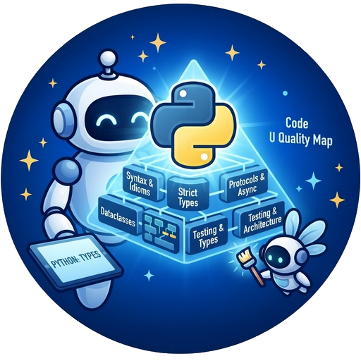

<p align="center">
  
</p>

# clean-code-python

Плагин для Claude Code: агент пишет, правит и ревьюит Python-код идиоматично, со строгими типами, понятными тестами, корректным asyncio и архитектурой по размеру задачи. Код он пишет под ту версию Python и pytest, что стоит в проекте. Это дополнение к языконезависимому плагину clean-code: общие правила об именах, функциях и ответственности берутся оттуда, здесь — их Python-форма и то, чего нет в других языках.

## Пример

Задача: «Добавь загрузку отчётов по списку URL параллельно, с таймаутом» в проекте с `requires-python = ">=3.12"`.

Без плагина агент часто пишет так, как учат старые туториалы: `Optional[List[Dict[str, Any]]]` в сигнатуре, `asyncio.gather` без обработки ошибок и `wait_for` вокруг каждого запроса. Если тайм-аутится один запрос, остальные продолжают работать в фоне. Тест он пишет с `mock.patch` на HTTP-клиент и проверкой вызовов мока.

С плагином агент сначала смотрит `requires-python` и пишет под 3.12. Он берёт `TaskGroup` и `async with timeout(...)` с разбором ошибок через `except*`, а в сигнатуре — `Sequence[Report] | None` со своими типами вместо словарей. HTTP-клиент передаётся параметром. Тест подставляет fake-клиент и проверяет результат, а не вызовы.

## Установка

Подключить маркетплейс и установить плагин вместе с clean-code — правила рассчитаны на работу в паре:

```
/plugin marketplace add maximsakhno/skills
/plugin install clean-code@maximsakhno
/plugin install clean-code-python@maximsakhno
```

С Claude Code 2.1.275 и новее хватит одной команды на плагин:

```
/plugin install clean-code-python --marketplace maximsakhno/skills
```

## Как правила попадают к агенту

Агент загружает скилл сам, когда задача касается Python-кода: написать, изменить, отрефакторить, поревьюить, добавить типы или тесты. Вызвать вручную: `/clean-code-python:clean-code-python`.

Скилл разбит на файлы, чтобы в контекст попадало только нужное:

- `skills/clean-code-python/SKILL.md` — основной свод: версия проекта, идиомы, коллекции, функции, классы, свои типы, аннотации, исключения, модули. Загружается всегда.
- `versions.md` — что в какой версии Python появилось, устарело и удалено (3.8–3.15). Агент открывает его, когда сверяет код с версией проекта.
- `testing.md` — тестирование без привязки к фреймворку. Агент читает его перед тем, как писать тесты.
- `pytest.md` — правила pytest и таблицы изменений API до 9.2. Агент читает его, только если в проекте pytest, и пишет тесты под версию pytest из проекта.
- `asyncio.md` — async-код и конкурентность.
- `architecture.md` — слои, домен, Repository, Unit of Work, DI, события и критерии, когда они лишние.

## Ограничения

- Правила — инструкция агенту, а не проверка. Они не заменяют линтер, тайпчекер, тесты и ревью человеком.
- Конвенции проекта, его линтер и `CLAUDE.md` важнее этого свода.
- Таблицы версий доведены до Python 3.15 и pytest 9.2. Для более новых версий агент не узнает о новых возможностях из скилла.
- Не покрыты упаковка и публикация пакетов, настройка инструментов (ruff, mypy, uv), фреймворки (Django, FastAPI) и научный стек (NumPy, pandas).
- В наборе источников была только первая редакция книги о pytest (2017), поэтому правила pytest опираются в основном на официальную документацию.

## Как изменить правила

Править файлы в `skills/clean-code-python/`. Правило записывается пунктом: действие глаголом в неопределённой форме, причина в 1–3 предложениях, пример «плохо → хорошо». Если добавляете файл, укажите в таблице «Какие файлы читать» в `SKILL.md`, когда его открывать. После правки проверить плагин:

```
claude plugin validate /path/to/clean-code-python
```

и попробовать на задаче через `claude --plugin-dir /path/to/clean-code-python`.

## Откуда правила

- Luciano Ramalho, «Fluent Python» (2nd ed., 2022)
- Brett Slatkin, «Effective Python: 125 Specific Ways to Write Better Python» (3rd ed., 2024)
- Patrick Viafore, «Robust Python» (2021)
- Mariano Anaya, «Clean Code in Python» (2nd ed., 2021)
- Brian Okken, «Python Testing with pytest» (1st ed., 2017)
- Matthew Fowler, «Python Concurrency with asyncio» (2022)
- Harry Percival, Bob Gregory, «Architecture Patterns with Python» (2020)
- Harry Percival, «Test-Driven Development with Python» (3rd ed., 2025)
- Al Sweigart, «Beyond the Basic Stuff with Python» (2020)
- Python Software Foundation, «What's New in Python» 3.8–3.15
- Документация pytest: changelog 3.3–9.2, Deprecations and Removals, руководства

Где авторы расходились, в своде выбран один вариант — тот, что лучше служит понятности, строгой типизации и простоте изменения кода.

## Лицензия

MIT, см. [LICENSE](../../LICENSE).
