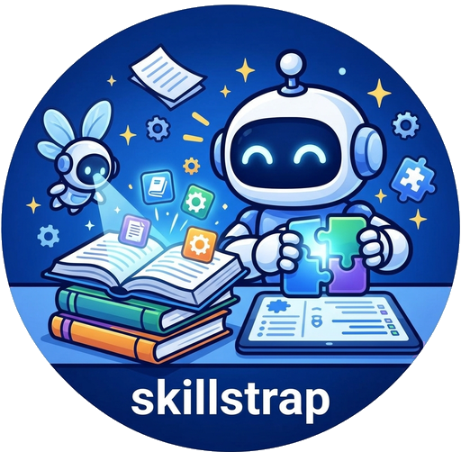

<p align="center">
  
</p>

# skillstrap

Плагин для Claude Code, который собирает скилл по любой теме из лучших книг о ней. Агент подбирает с вами книги, конспектирует каждую отдельным субагентом и сводит конспекты в правила с примерами. Результат — готовый плагин, устроенный как [clean-writing](../clean-writing).

Например, по запросу `/skillstrap:skillstrap манифесты Kubernetes` агент:

1. Уточняет, что агент должен делать лучше, и предлагает имя плагина.
2. Ищет книги в интернете и показывает таблицу: книга, последнее издание, какую грань темы она добавляет. Вы отмечаете номера, и раунды идут, пока книг не хватит.
3. Создаёт папку `k8s-manifests/books/` и ждёт, пока вы положите туда книги.
4. Конвертирует книги в Markdown через [markitdown](https://github.com/microsoft/markitdown).
5. Запускает по субагенту на книгу: каждый читает её целиком и пишет конспект из правил и примеров.
6. Сводит конспекты в `SKILL.md`, пишет README и проверяет плагин.

## Установка

```
/plugin marketplace add maximsakhno/skills
/plugin install skillstrap@maximsakhno
```

С Claude Code 2.1.275 и новее хватит одной команды:

```
/plugin install skillstrap --marketplace maximsakhno/skills
```

Для конвертации книг нужен `python3` и markitdown. Если markitdown не установлен, скрипт запустит его через `uvx`, для этого нужен [uv](https://docs.astral.sh/uv/). Установить markitdown самому: `pip install 'markitdown[all]'`.

## Что получается

```
k8s-manifests/
├── .claude-plugin/plugin.json
├── skills/k8s-manifests/SKILL.md    свод правил
├── README.md, LICENSE, .gitignore
├── books/  .build/  notes/          книги, их текст и конспекты, не в git
```

Агент загружает скилл сам, когда задача подходит под его описание.

## Ограничения

- **Книги добываете вы.** Агент не скачивает книги, только подбирает их. Книги и конспекты с цитатами остаются в `.gitignore`.
- **Сканы не читаются.** PDF без текстового слоя нужно сначала распознать. FB2, MOBI, AZW3 и DjVu markitdown не поддерживает: их нужно сконвертировать в EPUB, например через Calibre.
- **Сборка дорогая.** Каждый субагент читает книгу целиком: книга на 300 страниц — это 100–200 тысяч токенов только на чтение.

## Как устроен скилл

- `skills/skillstrap/SKILL.md` — процесс по шагам;
- `skills/skillstrap/summary-prompt.md` — промпт субагента, который конспектирует книгу;
- `skills/skillstrap/scripts/convert_books.py` — конвертация книг в Markdown;
- `skills/skillstrap/scripts/scaffold.py` — создание файлов плагина по шаблону;
- `skills/skillstrap/template/` — шаблоны `.gitignore` и лицензии.

Проверить плагин и запустить его без маркетплейса:

```
claude plugin validate .
claude --plugin-dir .
```

## Лицензия

MIT, см. [LICENSE](../../LICENSE).
